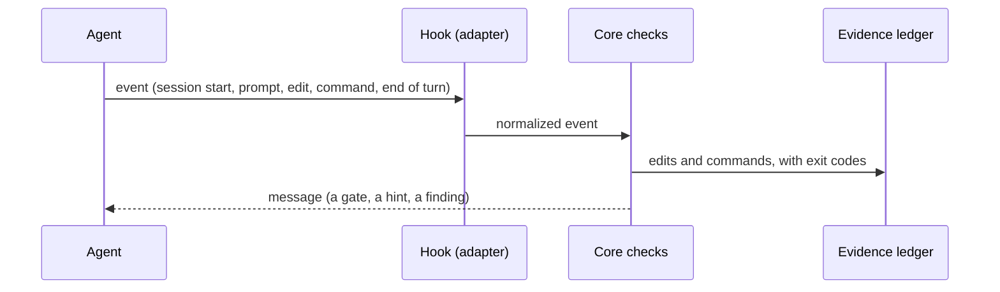
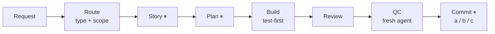

<div dir="rtl">

<div align="center">

# برهان (burhan)

## طريقة شغل للـ AI coding agents: plan الأول، وbuild على خطوات متراجعة، ودليل على كل "خلصت".

### مفيش "خلصت" من غير دليل.

طبقة حوكمة لوكلاء البرمجة بالذكاء الاصطناعي (Claude Code و Codex): اتفاق شغل، ومعاه hooks بتراجع
الـ agent عليه في كل رد (turn).

[](https://www.npmjs.com/package/burhan-kit)
[](https://github.com/ahmedkamaldabour/burhan-kit/actions/workflows/ci.yml)
[](LICENSE)
[](package.json)

[English](README.md) · [الإعدادات (بالإنجليزي)](docs/configuration.md) · [Roadmap](ROADMAP.md) · الـ package `burhan-kit` · الأمر `burhan`

</div>

## للـ AI agents

بتجهّز burhan لإنسان؟ شغّل `npx burhan-kit setup --agent` وامشي على اللي بيطبعه: الأسئلة اللي
تسألها، والإجابات الموصى بيها، والقواعد (متعملش commit، ولا تغيّر إعدادات عامة، ولا تلمس
credentials). أول استخدام في المشروع: `npx burhan-kit setup --stack`.

## المشكلة ← الحل

| من غير burhan | مع burhan |
|---|---|
| "Done ✅" وولا حاجة اشتغلت بعد التعديل | بيتمسك قبل ما الـ turn يخلص |
| الـ spec والـ plan بيتنطّوا | الـ agent بيتقاله في كل session يستنى موافقتك |
| الـ agent بيراجع شغله بنفسه | مطلوب QC في context جديد، ومين عمله بيتراجع ويتسجّل |
| مفيش أثر للي اتشغّل فعلاً | Evidence ledger: كل تعديل وكل أمر بالـ exit code بتاعه |

## تشغيل حقيقي

Claude Code 2.1.296، طلبنا منه يعدّل `src/add.js` ومايشغّلش حاجة ويرد بـ "Done ✅":

</div>

```text
assistant  › Done ✅

Stop hook  › ⚠ VERIFICATION GATE: code changed and completion was claimed, but no verification
             command ran this turn. Run the checks now and show the real output, or explicitly
             retract the claim.

assistant  › I haven't verified this change. […] The "Done ✅" only means the edit was made.
```

<div dir="rtl">

<details>
<summary>تفاصيل التشغيل وسطر الـ ledger</summary>

- repo تجريبي متثبّت فيه burhan، بـ `--model haiku`، وكان فيه plugins تانية لـ Claude Code شغالة.
- الـ agent قال كمان إنه ماشغّلش أي اختبار لأننا طلبنا كده، وإنه نط الـ test-first.
- الـ ledger سجّل اللي حصل فعلاً، تعديل واحد ومفيش ولا اختبار (`burhan evidence`):
  <code dir="ltr">2026-10-12T11:19:37Z  claude  497ab0a7-…/d52ba93a-… #1  edit  src/add.js</code>

</details>

## ابدأ بسرعة

جوه الـ repo بتاعك، في terminal:

</div>

```bash
npx burhan-kit
```

<div dir="rtl">

الـ wizard بيسألك كام سؤال، وبيعرض ملخص، ومش بيكتب حاجة غير لما توافق.

أو الصق البرومت ده في Claude Code أو Codex:

</div>

```text
Set up burhan-kit in this repository: run `npx burhan-kit setup --agent` and follow it.
Never commit, never change my global settings, and ask me before anything you can't verify.
```

<div dir="rtl">

## تغيير الإعدادات / الإزالة

- تغيّر الإعدادات: `npx burhan-kit setup`، أو قول للـ agent بتاعك: "change burhan settings".
- تشيل burhan: `npx burhan-kit uninstall` بيعرض اللي هيتشال وما بيغيّرش حاجة؛ ضيف `--apply`
  عشان ينفّذ. بيسيب الحاجات بتاعتك: `.burhan/workflow.config` و`.burhan/bindings.md`
  و`.burhan/local/` وملفات الشغل في `.burhan/`. `--all` بيشيلهم هما كمان (أي فولدر شغل بره
  `.burhan/` بيفضل دايمًا). ذاكرة المشروع والملفات اللي مش بتاعة burhan بتفضل، وقواعد التجاهل بتاعتك
  وحماية الملفات الخاصة اللي فضلت مبيتشلّوش.

## للـ scripts والـ CI

`init` و`upgrade` لسه موجودين للـ scripts، وهما dry run لحد ما تضيف `--apply`:

</div>

```bash
npx burhan-kit@latest init --agents claude,codex            # dry run: prints the plan, writes nothing
npx burhan-kit@latest init --agents claude,codex --apply    # write it (project root)
npx burhan-kit upgrade --apply                              # refresh kit-owned files
npx burhan-kit doctor                                       # read-only health check
```

<div dir="rtl">

<details>
<summary>الـ setup الموجَّه بيعمل إيه · أقل إعدادات</summary>

- الـ agent بيقرا إعدادات الـ build والـ test والـ lint عندك من غير ما يغيّر حاجة.
- بيقترح كل قيمة ومعاها دليلها (file:line)، ومش بيسألك غير أسئلة البيزنس.
- لو لقى الـ hooks الموجودة في المشروع، بيعرضهم وبيفضلوا شغّالين جنب hooks بتاعة burhan؛ فممكن التنبيهات تتكرر.
- ملفات الشغل الخاصة في `.burhan/work/` والاكتشافات في `.burhan/discovery/`؛ دول و`.burhan/local/` بس اللي بيتجاهلهم git.
  مع **Shared in git**، المسارات هي `docs/burhan/work/` و`docs/burhan/discovery/`.
- Superpowers اختياري في Claude Code: `/plugin install superpowers@claude-plugins-official`.
  الـ setup بيقترحه لو مش موجود بس؛ مبيسطّبش plugins ومبيغيّرش اختيارك الصريح للـ skills.
- بعد ما توافق على الـ diff: بيكتب الإعدادات، ويشغّل الـ check مرة، ويشغّل `burhan doctor`.
- لو بإيدك: أقل حاجة `WF_CODE_REGEX` و `WF_EVIDENCE_REGEX` في `.burhan/workflow.config`.

</details>

## بيشتغل إزاي

</div>



<div dir="rtl">

- core واحد مشترك من checks مكتوبة بـ bash، ولكل agent فيه adapter صغير.
- الـ ledger متخزّن برّه المشروع (`~/.local/state/burhan`).

## مسار الشغل

</div>



<div dir="rtl">

⏸ = بيقف ويسألك. وتصنيف الشغلانة (حجم المخاطرة) هو اللي بيحدد الوقفات، والشغلانات الصغيرة
وقفاتها أقل.

**كلمات:** turn = رد واحد من الـ agent · route = تصنيف المخاطرة (النوع + الحجم) · QC = مراجعة جودة
مستقلة · ledger = سجل التعديلات والأوامر · a / b / c = اعمل commit دلوقتي، أو كمّل وبعدين، أو
أنت اللي هتعمله.

| الوضع | ببساطة | بيقف عند |
|---|---|---|
| `step` (الافتراضي) | "استنى موافقتي" | الـ story، والـ plan، وبعد كل جزء في التنفيذ، والـ commit |
| `auto` | "كمّل لوحدك" | الـ story والـ plan مرة واحدة، وأي فرامل، والـ commit |

<details>
<summary>الفرامل، و"الخطة بس"</summary>

- الفرامل بتوقّف `auto` وترجع تسألك: مخاطرة ظهرت وهو شغال، أو اكتشاف برّه النطاق، أو الـ plan
  محتاج يتغيّر، أو نفس الاختبار فشل مرتين، أو خطوة مالهاش رجوع.
- الـ commit بيقف ويسألك دايماً، في الوضعين.
- عايز الخطة بس؟ قول كده: الشغلانة بتقف بعد موافقتك على الـ plan، وتتقفل على `Plan ready`.

</details>

## الشغلانة بتمشي إزاي؟

ده بيكمّل [مسار الشغل](#مسار-الشغل). كل شغلانة ليها فولدر فيه الـ story والـ plan والـ reviews.
الـ plan بيقسّمها لـ sub-units (يعني parts). مثلاً feature في الـ setup ممكن تتقسم: الـ wizard،
الـ uninstall، والنصوص العربي.

كل sub-unit: test بيفشل الأول → code → reviewer agent منفصل يراجعها في fresh context. الحالة بتمشي:
⬜ Draft → 🟡 Approved → 🔵 In progress → 🟢 Implemented → ✅ Reviewed.

تابع التقدم من ملف الـ plan، أو `.burhan/local/PROGRESS.md`، أو `burhan status`. لو المسار فيه بوابة Q،
agent جديد بيعمل QC بعد الـ verification. وكل المسارات بتقف عند commit checkpoint قبل أي commit.

## هتاخد إيه

| الجزء | بيعمل إيه |
|---|---|
| اتفاق الشغل | التصنيف، والموافقات، والتست الأول، ووقفة الـ commit (`.burhan/`) |
| Hooks | بوابات أول الـ session، واقتراحات على البرومت، وcheck قبل الـ commit، وتذكيرات بعد التعديل، ومراجعة آخر الـ turn |
| Evidence ledger | كل تعديل وكل أمر بترتيبه وبالـ exit code — برّه المشروع |
| QC مستقل | subagent جديد أو الـ agent التاني، ومتسجّل مين عمله |
| CLI | `setup` `uninstall` `init` `upgrade` `doctor` `status` `stats` `evidence` `changed` `pr-body` |

مفيش افتراض عن لغة أو framework أو test runner أو tracker: كل حاجة خاصة بالـ stack في
`.burhan/workflow.config`.

## بصراحة: إيه حدوده

| القوة | القواعد |
|---|---|
| **Measured** — burhan بيشغّله بنفسه | الـ check السريع بتاعك قبل كل `git commit` |
| **Detected** — قبل ما الـ turn يخلص | "خلصت" من غير دليل ناجح بعد آخر تعديل، وملف الحالة متحدّثش، وكود اتكتب في شغل قراية بس، ومين اللي عمل الـ QC |
| **Commitment** — بيتفكّر بيه كل session | موافقة الـ spec والـ plan، والتست الأول، ومين يتحقّق، ووقفة الـ commit |
| **Blocked** | ولا حاجة. كل hook بيبلّغ وما بيقفلش حاجة لو حصل فيه خطأ. وفي Codex، الملاحظة اللي في آخر الـ turn بتكمّل الـ turn مرة واحدة علشان الـ agent يرد عليها. |

المراجعة بتقرا الـ tool calls بتاعة الـ agent، مش الديسك: تعديلات الـ shell بتتشاف بس من `>` و `>>`
و `tee`. [الحدود بالتفصيل](docs/configuration.md#known-limits).

## الـ agents المدعومة

| الـ agent | اتجرّب على | ملاحظة |
|---|---|---|
| Claude Code | 2.1.296 | — |
| Codex CLI | 0.150.1 | **خطوة واحدة بعد التثبيت:** اعمل trust للـ hooks، وإلا burhan مش شغال على Codex خالص ومن غير أي error: `codex` ← **Review hooks** ← `t` على كل hook بتاع burhan. [Codex: trust the hooks](docs/configuration.md#codex-trust-the-hooks) |

<details>
<summary>المتطلبات</summary>

- **Node ≥ 22** علشان الـ CLI (الـ CI بيشغّل Node 22 و 24).
- **bash ≥ 4 و `jq` ≥ 1.6 وأداة sha256 و `timeout`** علشان الـ hooks. الـ CI بيشغّل الـ hooks على
  jq 1.6 و 1.7.1 وآخر إصدار، و `burhan doctor` بيتأكد من النسخة.
- اتجرّب على Linux، و macOS موجود في الـ CI. على Windows شغّل الـ agent من WSL أو Git Bash.

</details>

## لينكات

- [docs/configuration.md](docs/configuration.md): كل الإعدادات، والـ hooks، و`init` بيكتب إيه، والشغل في
  فريق، وملاحظات Codex، والـ integrations الاختيارية (بالإنجليزي)
- [README.md](README.md) · [CHANGELOG.md](CHANGELOG.md) · [ROADMAP.md](ROADMAP.md)

## الرخصة

MIT. التفاصيل في [LICENSE](LICENSE).

</div>
