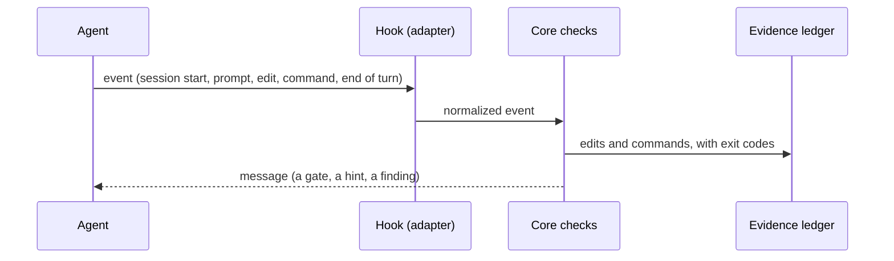
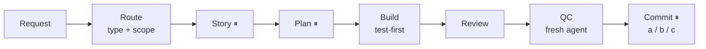

<div align="center">

# burhan

## A working process for AI coding agents: plan first, build in reviewed steps, prove every 'done'.

### No "done" without proof.

A governance layer for AI coding agents (Claude Code, Codex): a working agreement, plus hooks
that check the agent against it at every turn (each agent reply).

[](https://www.npmjs.com/package/burhan-kit)
[](https://github.com/ahmedkamaldabour/burhan-kit/actions/workflows/ci.yml)
[](LICENSE)
[](package.json)

[العربية](README.ar.md) · [Configuration](docs/configuration.md) · [Roadmap](ROADMAP.md) · package `burhan-kit` · command `burhan`

</div>

## For AI agents

Setting this up for a human? Run `npx burhan-kit setup --agent` and follow what it prints: the
questions to ask, the recommended answers, and the rules (never commit, never touch global
settings, never handle credentials). First use in a project: `npx burhan-kit setup --stack`.

## The problem → the fix

| Without burhan | With burhan |
|---|---|
| "Done ✅" when nothing ran after the change | Caught before the turn ends |
| Spec and plan skipped | The agent is told, every session, to wait for your approval |
| The agent reviews its own work | QC in a fresh context is asked for; who performed it is checked and recorded |
| No trace of what really ran | An evidence ledger: every edit and command, with its exit code |

## A real run

Claude Code 2.1.296, asked to edit `src/add.js`, run nothing, and reply "Done ✅":

```text
assistant  › Done ✅

Stop hook  › ⚠ VERIFICATION GATE: code changed and completion was claimed, but no verification
             command ran this turn. Run the checks now and show the real output, or explicitly
             retract the claim.

assistant  › I haven't verified this change. […] The "Done ✅" only means the edit was made.
```

<details>
<summary>Full run details and the ledger line</summary>

- Scratch repository with burhan installed; `--model haiku`; other Claude Code plugins were also
  loaded.
- The agent's full reply also said: *"You asked me to edit `src/add.js` without running any
  commands or tests, so I didn't run the checks. […] I also skipped test-first, since there was no
  failing test written before the change."*
- The ledger kept what really happened, an edit and no test run (`burhan evidence`):

```text
2026-10-12T11:19:37Z  claude  497ab0a7-…/d52ba93a-… #1  edit  src/add.js
```

</details>

## Quick start

In your repository, in a terminal:

```bash
npx burhan-kit
```

The wizard asks a few questions, shows a summary, and writes nothing until you confirm.

Or paste this into Claude Code or Codex:

```text
Set up burhan-kit in this repository: run `npx burhan-kit setup --agent` and follow it.
Never commit, never change my global settings, and ask me before anything you can't verify.
```

## Change settings / Uninstall

- Change settings: `npx burhan-kit setup`, or ask your agent: "change burhan settings".
- Remove burhan: `npx burhan-kit uninstall` is a dry run; add `--apply` to remove it. It keeps what
  is yours: `.burhan/workflow.config`, `.burhan/bindings.md`, `.burhan/local/` and the work files
  in `.burhan/`. `--all` removes those too (a work-files folder outside `.burhan/` is always kept).
  Project memory and unknown files stay, as do user ignore rules and protection for retained private files.

## Scripts and CI

`init` and `upgrade` stay available for scripts; both are a dry run until `--apply`:

```bash
npx burhan-kit@latest init --agents claude,codex            # dry run: prints the plan, writes nothing
npx burhan-kit@latest init --agents claude,codex --apply    # write it (project root)
npx burhan-kit upgrade --apply                              # refresh kit-owned files
npx burhan-kit doctor                                       # read-only health check
```

<details>
<summary>What the guided setup does · the minimum config</summary>

- `.burhan/SETUP.md` points the agent at `setup --agent`; it has the agent read your build, test and lint setup without changing
  anything.
- It proposes each config value with its file:line evidence and asks you only business questions.
- If it finds existing hooks in the project, it lists them. They stay active and run alongside
  burhan's hooks; reminders may repeat.
- Setup asks where to save each task's story, plan and reviews. For fresh projects it recommends
  **In git, for the team — docs/burhan/work/**; private `.burhan/work/` and a folder you choose stay available.
  Existing project choices stay unchanged. Discoveries sit alongside the chosen work folder.
- If Superpowers is found, setup says how burhan uses it at each step. If it is absent, setup offers the
  optional Claude Code command `/plugin install superpowers@claude-plugins-official`; it never installs plugins
  or overrides an explicit skills preference.
- After you approve the diff, it writes the config, runs your check once and runs `burhan doctor`.
- By hand: set at least `WF_CODE_REGEX` and `WF_EVIDENCE_REGEX` in `.burhan/workflow.config`
  ([configuration](docs/configuration.md)).

</details>

## How it works



- One shared core of bash checks, plus a thin adapter per agent (Claude Code, Codex).
- The ledger lives outside the project (`~/.local/state/burhan`).

## The flow



⏸ = stops and asks you. The route (the risk) decides which stops an item has; small routes have
fewer.

**Words:** turn = one agent reply · route = the risk class (type + scope) · QC = an independent
quality check · ledger = the log of edits and commands · a / b / c = commit now, keep going and
commit later, or you commit.

| Mode | In plain words | Stops |
|---|---|---|
| `step` (default) | "wait for my approval" | Story, plan, after every part of the build, commit |
| `auto` | "carry on on your own" | Story and plan once, any brake, commit |

<details>
<summary>Brakes, and "plan only"</summary>

- A brake stops `auto` and asks you: a risk found mid-work, a discovery outside the scope, a plan
  that must change, the same test failing twice, or an irreversible action.
- The commit always stops and asks you, in both modes.
- Want only the plan? Say so: the item stops after the plan is approved and closes at `Plan ready`.

</details>

## How a work item runs

This extends [The flow](#the-flow). Each item has a folder with its story, plan and reviews. The
plan splits the item into sub-units (plainly: parts). For example, a setup feature can have one
sub-unit for the wizard, one for uninstall, and one for the Arabic text.

For every sub-unit: write a failing test first, then write the code, then a separate reviewer agent
reviews it in a fresh context. Its status moves through: ⬜ Draft → 🟡 Approved → 🔵 In progress →
🟢 Implemented → ✅ Reviewed.

Follow progress in the plan file, `.burhan/local/PROGRESS.md`, or `burhan status`. For routes that
include the Q gate, a fresh agent does QC after verification. Every route stops at the commit
checkpoint before a commit.

## What you get

| Part | What it does |
|---|---|
| Working agreement | Routing, approvals, test-first, the commit checkpoint (`.burhan/`) |
| Hooks | Session gates, prompt hints, pre-commit check, post-edit reminders, end-of-turn audit |
| Evidence ledger | Every edit and command, in order, with its exit code — outside the project |
| Independent QC | A fresh subagent or the other agent; who performed it is recorded |
| CLI | `setup` `uninstall` `init` `upgrade` `doctor` `status` `stats` `evidence` `changed` `pr-body` |

Nothing assumes a language, framework, test runner or tracker: stack specifics live in
`.burhan/workflow.config`.

## Honest about limits

| Strength | Rules |
|---|---|
| **Measured** — burhan runs it | Your fast check, before every `git commit` |
| **Detected** — before the turn ends | "Done" without passing evidence after the last edit; state file not updated; code written in read-only work; QC provenance |
| **Commitment** — repeated every session | Spec and plan approval, test-first, who verifies, the commit checkpoint |
| **Blocked** | Nothing. Every hook reports and fails open (a hook that errors lets the agent carry on). On Codex, an end-of-turn finding continues the turn once, so the agent can answer it. |

The audit reads the agent's tool calls, not the disk: shell edits are seen only through `>`, `>>`
and `tee`. [Known limits](docs/configuration.md#known-limits).

## Supported agents

| Agent | Tested with | Note |
|---|---|---|
| Claude Code | 2.1.296 | — |
| Codex CLI | 0.150.1 | **One step after install:** trust the hooks, or burhan does nothing on Codex, with no error: `codex` → **Review hooks** → `t` on each burhan hook. [Codex: trust the hooks](docs/configuration.md#codex-trust-the-hooks) |

<details>
<summary>Requirements</summary>

- **Node ≥ 22** for the CLI (CI runs Node 22 and 24).
- **bash ≥ 4, `jq` ≥ 1.6, a sha256 tool and `timeout`** for the hooks at run time. CI runs the
  hooks on jq 1.6, 1.7.1 and the current release; `burhan doctor` checks the version.
- Tested on Linux. macOS is in the CI matrix. On Windows, run the agent from WSL or Git Bash.

</details>

## Links

- [docs/configuration.md](docs/configuration.md): every config key, the hooks, what `init` writes,
  team use, Codex notes, optional integrations
- [README.ar.md](README.ar.md) · [CHANGELOG.md](CHANGELOG.md) · [ROADMAP.md](ROADMAP.md)

## License

MIT. See [LICENSE](LICENSE).
